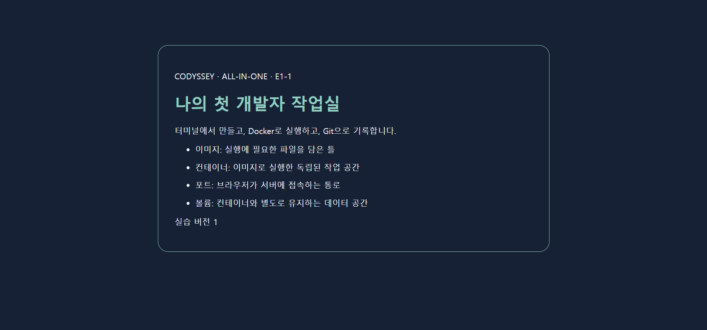

# E1-1 · 내 컴퓨터에 개발자용 작업실 꾸미기

터미널에서 파일을 다루고, 직접 만든 웹페이지를 Docker로 실행하고, Git으로 변경 이력을 남기는 개인 미션입니다. Windows의 Ubuntu WSL2와 Docker Desktop에서 실제 실습을 수행했습니다.

**구현·로컬 검증·GitHub 반영 완료 / 주소창 포함 캡처와 네이토 재평가 대기.** 네이토 마지막 확인 결과는 1차 **61% (11/18)**입니다. 이후 보완 사항은 원격에 반영했으며, 개선 점수는 아직 확인하지 않았습니다.

[빠른 실행](#빠른-실행) · [요구사항과 증거](#요구사항과-증거) · [실제 실행 결과](#실제-실행-결과) · [배운 내용](#이-과제에서-배우는-것) · [평가 현황](#평가-및-남은-항목)

## 결과물

- [Dockerfile](Dockerfile): NGINX 이미지에 직접 작성한 HTML을 포함하고 HTTP 상태 검사를 추가했습니다.
- [웹페이지 소스](site/index.html): 이미지·컨테이너·포트·볼륨을 설명하는 한국어 페이지입니다.
- [전체 검증 스크립트](scripts/verify.sh): 파일 권한부터 HTTP 응답, 마운트, 데이터 유지, Git 커밋까지 검사합니다.
- [실제 PTY 검증](scripts/attach_demo.py): attach 접속·분리와 exec 종료 후 컨테이너 유지 여부를 확인합니다.
- [아주 쉬운 설명 PPT 18장](learning/E1-1_개발자작업실_아주쉬운설명.pptx): 개념 비유와 작은 실습, 확인 질문을 담았습니다.

아래 이미지는 HTML 파일의 **정적 미리보기**입니다. Docker 서버 접속이나 주소창 증거로 사용하지 않습니다.



## 빠른 실행

### 1. 준비

Windows 사용자는 Docker Desktop을 실행하고 Ubuntu WSL 통합을 활성화한 뒤 **Ubuntu 터미널**에서 진행합니다. 아래 명령은 PowerShell용이 아닌 Bash용입니다. Linux에서는 Docker Engine에 연결 가능한 Bash를 사용합니다. Git과 curl도 필요합니다.

```bash
docker --version
docker info
git --version
```

`docker --version`은 CLI 설치만 확인합니다. `docker info`에 **Server** 정보까지 나와야 다음 단계로 진행할 수 있습니다. 연결 오류는 [Windows 안내](docs/windows-handoff.md)와 [문제 해결](docs/troubleshooting.md)을 참고합니다.

### 2. 내려받고 빌드

```bash
git clone https://github.com/Anyoungju/CODYSSEY-ALLINONE.git
cd CODYSSEY-ALLINONE/E1-1
docker build -t allinone-e1-1:local .
```

빌드가 끝나면 이미지가 생성됩니다. 베이스 태그 `nginx:stable-alpine`은 갱신될 수 있으므로 당시 정확한 이미지 digest는 [실제 빌드 로그](docs/EXECUTION_EVIDENCE.md#이미지-빌드-성공과-목록)를 확인합니다.

### 3. 실행하고 확인

```bash
docker run -d --name allinone-e1-1 -p 127.0.0.1:8080:80 allinone-e1-1:local
curl --fail http://127.0.0.1:8080/
docker ps --filter name=allinone-e1-1
docker inspect --format '{{.State.Health.Status}}' allinone-e1-1
```

브라우저에서 **http://localhost:8080/** 을 열면 ‘나의 첫 개발자 작업실’이 나타납니다. curl 결과에는 같은 제목의 HTML이 포함됩니다. 시작 직후에는 상태가 `starting`일 수 있으며 준비가 끝나면 `healthy`가 됩니다. 바로 접속되지 않으면 잠시 후 다시 확인합니다.

```text
내 브라우저 → 호스트 127.0.0.1:8080 → 컨테이너 80 → NGINX → index.html
```

컨테이너는 별도 네트워크 네임스페이스 안에서 실행됩니다. `-p 127.0.0.1:8080:80`은 호스트의 8080으로 온 요청을 컨테이너 내부 80으로 포워딩합니다. `EXPOSE 80`만으로 호스트 접속 포트가 열리지는 않습니다.

### 4. 종료와 재실행

```bash
docker stop allinone-e1-1
docker start allinone-e1-1
# 실습을 끝낸 후 이 컨테이너만 삭제
docker stop allinone-e1-1
docker rm allinone-e1-1
```

같은 이름의 컨테이너가 이미 있으면 새 `docker run` 대신 `docker start`를 사용합니다. 8080을 다른 프로그램이 사용한다면 원인을 확인하거나 `127.0.0.1:8081:80`으로 실행하고 8081로 접속합니다. [포트 진단과 해결 절차](docs/troubleshooting.md)를 참고합니다.

## 전체 실습 자동 검증

**저장소 최상위 폴더**에서 실행합니다. 앞의 빠른 실행을 따라왔다면 먼저 `cd ..`를 실행합니다.

```bash
bash E1-1/scripts/verify.sh
```

파일 조작, 권한 변경, Docker 기본 명령, attach/exec, 빌드, HTTP, 바인드 마운트, 볼륨 영속성, Git 실습을 수행합니다. 외부 Python 패키지는 필요 없으며 PTY 검증에 Python 3를 사용합니다.

- 성공 기준: 로그의 `ATTACH_EXEC_PASS`, `HEALTHCHECK_PASS`, 마지막 `VERIFICATION_PASS`.
- 실패 기준: 0이 아닌 종료 코드. 실패 직전 명령과 출력을 확인합니다.
- 로그 위치: `E1-1/evidence/verification.log`. 재실행 시 이 파일을 갱신합니다.
- 실행별 컨테이너·볼륨 이름을 사용하고 종료 시 해당 실행에서 만든 것만 정리합니다. 실습용 임시 폴더와 빌드 이미지는 남을 수 있습니다.
- 권한 실습은 WSL의 Linux 파일시스템 또는 `/tmp`에서 수행합니다. `/mnt/c`의 Windows 권한 동작과 구분합니다.

## 요구사항과 증거

| 과제 항목 | 수행 내용과 성공 기준 | 확인 자료 |
|---|---|---|
| 터미널·파일 | pwd, ls, mkdir, cd, touch, cat, cp, mv, rm 실행 | [명령과 실제 출력](docs/EXECUTION_EVIDENCE.md#터미널-및-파일폴더-권한-변경-전후) |
| 파일·폴더 권한 | 파일 600→644, 폴더 700→755, ls 출력 비교 | [권한 변경 전후](docs/EXECUTION_EVIDENCE.md#터미널-및-파일폴더-권한-변경-전후) |
| Docker 설치·연결 | 버전 및 info Server 정보, hello-world 메시지 | [Docker 점검](docs/EXECUTION_EVIDENCE.md#docker-버전과-데몬), [hello-world](docs/EXECUTION_EVIDENCE.md#hello-world-실제-실행) |
| 컨테이너 관리 | Ubuntu 실행·중지·재시작, logs/stats, attach/exec | [전체 실제 로그](evidence/VERIFIED_LOCAL_RESULTS.md), [PTY 스크립트](scripts/attach_demo.py) |
| 직접 작성 이미지 | Dockerfile 빌드 성공, 이미지 목록 확인 | [빌드 결과](docs/EXECUTION_EVIDENCE.md#이미지-빌드-성공과-목록) |
| 포트와 HTTP | 호스트 포트→내부 80, HTML 응답 | [실제 curl 응답](docs/EXECUTION_EVIDENCE.md#포트-매핑과-실제-curl-응답); 주소창 캡처 미수집 |
| 바인드 마운트 | 호스트 수정 후 응답에 bind mount updated | [변경 전후](docs/EXECUTION_EVIDENCE.md#바인드-마운트-반영과-볼륨-재생성-전후) |
| 볼륨 영속성 | 컨테이너 삭제·재생성 후 E1-1-persistent 유지 | [동일 데이터 확인](docs/EXECUTION_EVIDENCE.md#바인드-마운트-반영과-볼륨-재생성-전후) |
| Git·GitHub | main 커밋, 원격 연결 및 push | [Git 실습 출력](docs/EXECUTION_EVIDENCE.md#git-설정기본-브랜치커밋), [커밋 기록](https://github.com/Anyoungju/CODYSSEY-ALLINONE/commits/main/) |
| VSCode 연동 | GitHub 로그인 및 main/origin 소스 제어 | [계정 화면](evidence/vscode-github-account.png), [활성화된 소스 제어](evidence/vscode-source-control-linked.png) |
| 문제 해결 | 실행 권한·포트 실험의 원인과 조치 | [문제 해결 문서](docs/troubleshooting.md) |

[상세 요구사항 대응표](docs/requirements.md)에서 원문 기준의 범위를 확인할 수 있습니다. Compose·SSH 등 선택 항목은 필수 완료 조건과 구분합니다.

## 실제 실행 결과

다음은 **2026-11-03 로컬 실행 기록**입니다. 현재 PC 상태를 새로 측정한 값은 아닙니다.

| 환경 | 기록된 값 |
|---|---|
| 호스트 / 실행 환경 | Windows + Ubuntu WSL2 / Docker Desktop |
| Linux | 6.18.54.1-microsoft-standard-WSL2 |
| Bash / Git / Docker | 5.3.9 / 2.53.0 / 29.9.2 |
| 결과 | ATTACH_EXEC_PASS · HEALTHCHECK_PASS · VERIFICATION_PASS |

실제 출력 일부:

```text
-rw------- 1 root root 18 Nov  3 16:16 original.txt
-rw-r--r-- 1 root root 18 Nov  3 16:16 original.txt
Hello from Docker!
<h1>E1-1 bind mount updated</h1>
E1-1-persistent
```

볼륨의 `E1-1-persistent`는 컨테이너 삭제 전과 새 컨테이너 연결 후에 각각 확인했습니다. 자세한 명령 순서는 [핵심 출력 발췌](docs/EXECUTION_EVIDENCE.md), [전체 Markdown 기록](evidence/VERIFIED_LOCAL_RESULTS.md), [원본 로그](evidence/verification-local-fixed-2026-11-03.log)에 있습니다.

Linux CI에서도 별도로 검증했습니다. [추가 Docker 검증 성공 기록](https://github.com/Anyoungju/CODYSSEY-ALLINONE/actions/runs/41549393703)과 [보존 로그](evidence/verification-2026-11-03.log)를 확인할 수 있습니다. CI 결과와 Windows 로컬 증거는 구분합니다.

로컬 Docker Desktop에서는 동일 포트 요청이 거절되지 않는 차이를 관찰했습니다. 충돌 실험을 백그라운드 실행으로 바꾸고 실험 컨테이너를 정리하도록 수정했습니다. 초기 중단 로그도 [실패 기록](evidence/verification-local-2026-11-03.log)으로 보존했습니다.

## 이 과제에서 배우는 것

| 개념 | 쉽게 설명하면 | 이번 과제의 확인 방법 |
|---|---|---|
| 터미널·경로 | 현재 어느 폴더에서 무엇을 하는지 글로 지시하기 | pwd와 ls로 위치·내용 확인 |
| 권한 | 파일을 읽고 쓰고 실행할 수 있는 사람 정하기 | chmod 전후 ls 비교 |
| 이미지·컨테이너 | 실행 재료를 담은 틀과 그 틀로 실행한 작업 공간 | build 후 run, stop/start |
| 포트 | 내 컴퓨터에서 웹 서버로 들어가는 통로 | 호스트 8080과 내부 80 연결 |
| 바인드 마운트 | 내 폴더를 컨테이너가 직접 읽게 연결하기 | HTML 수정이 응답에 반영 |
| 볼륨 | 컨테이너가 바뀌어도 남길 보관함 | 새 컨테이너에서 기존 파일 읽기 |
| Git | 작업 변경을 설명과 함께 기록하기 | add, commit, log와 원격 push |

`COPY`로 이미지에 넣은 파일은 호스트 파일을 바꿔도 자동 갱신되지 않습니다. **재빌드 후 컨테이너를 새로 생성**해야 합니다. 바인드 마운트는 호스트 변경을 바로 읽습니다. 컨테이너 내부에만 한 수정은 새 컨테이너로 교체할 때 유지되지 않으므로 필요한 데이터는 별도 볼륨에 둡니다.

[개념·백업과 복원 예시](docs/learning.md), [쉬운 설명 PPT](learning/E1-1_개발자작업실_아주쉬운설명.pptx)를 함께 봅니다. 문서의 백업·복원 예시는 권장 절차이며 실제 실행 증거와 구분해 표시했습니다.

## 평가 및 남은 항목

- **1차 네이토:** 2026-11-05, 61% (11/18), 평가 소스 `72b3700`. [원본 결과](evaluation/naito-attempt-1.json)
- **보완:** 실제 출력과 설명을 추가하고 PASS 권고를 포함한 18개 의견을 검토했습니다. [항목별 조치](docs/POST_EVALUATION_REVIEW.md). 해당 보완은 `476c33b`까지 GitHub main에 반영되었습니다.
- **남은 증거:** 주소창에 localhost와 포트가 보이는 실제 Docker 서버 브라우저 캡처.
- **남은 평가:** 2차 네이토 결과는 아직 없습니다. 동료평가는 사용자가 진행합니다.
- **제출 상태:** 프로젝트 URL 저장과 최종 평가 요청은 별도입니다. 저장소 존재·CI 성공만으로 최종 제출 완료를 주장하지 않습니다.

## 파일 안내

```text
E1-1/
├── Dockerfile                   # 웹 실행 이미지
├── site/index.html              # 직접 작성한 페이지
├── scripts/verify.sh            # 전체 실습 검증
├── scripts/attach_demo.py       # 실제 attach/exec 검증
├── docs/                       # 요구사항·개념·출력 발췌·문제 해결
├── evidence/                   # 실제 원본 로그와 화면
├── evaluation/                 # 네이토 평가 결과
└── learning/                   # 쉬운 설명 PPT
```

[검증 이력과 증거의 한계](evidence/STATUS.md) · [저장소 첫 화면](../README.md)
